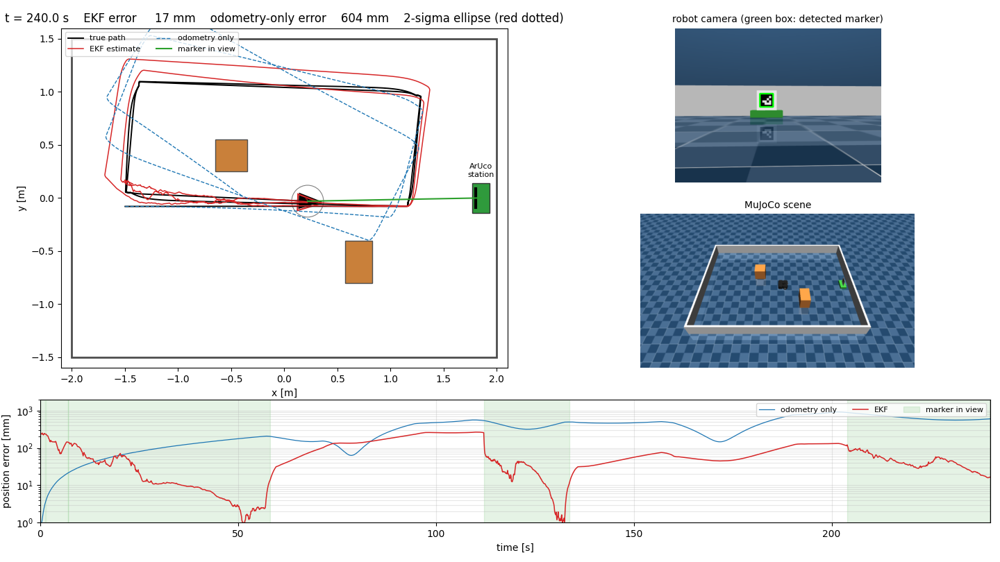

# 41014/42043 Integrated Project - Track A: Visual Waypoint Navigation

A TurtleBot3 with a 2D LiDAR and a camera in MuJoCo navigates a room with obstacles and docks to an ArUco-marked charging station. The estimator and controller use the estimated state only; simulator ground truth is used for evaluation and drawing only.



*A logged run on the simulated robot. Black: true path. Red: EKF estimate (dotted ellipse: its 2-sigma position uncertainty). Blue dashed: odometry only. Green shading in the error plot: the marker is in view.*

## Demo video

**Video:** https://youtu.be/aT5Kv-MqD9I (4:58: the live run, then modelling, sensing, estimation, control and robustness).

## Key results (simulation, MuJoCo 3.3.7)

- **Navigation and docking:** seven room layouts with obstacles the robot does not know, six random start offsets each, three rounds: **126 of 126 runs docked with no collision**. In the last round every docked run ended within 12 mm along-track, 25 mm lateral and 4.9 degrees of the dock pose ([findings](docs/findings.md), stage 11).
- **Robustness:** with three times the LiDAR noise, three times the start offset, half of the camera frames lost, a 5 percent wheel-radius error or a push the encoders cannot see, **26 of 30 docked** on fresh seeds. The failures happen when the marker is out of view for a long time and the pose drifts.
- **Marker position not given:** the marker pose can be estimated together with the robot pose (one-landmark EKF-SLAM); 16 of 16 completed runs on fresh seeds docked (stage 11b).
- **Honest limits:** simulation only; the filters are overconfident on simulator data (ANEES at least 17 against an ideal 3); the dock tolerance and the LiDAR parameters are provisional; the layouts are my own.

## Status

| Part | State |
|---|---|
| State-space model, observability and controllability analysis | Done, checked numerically ([docs/findings.md](docs/findings.md), stage 1) |
| Driver layer (wheel-speed loop on the simulated motors, encoders) | Done and validated in MuJoCo |
| Scene (room, obstacles, ArUco station), camera, marker pose from corners | Done and validated in MuJoCo |
| EKF with fixed odometry gains, gains estimated online, or both; EKF-SLAM when the marker position is unknown | Done; validated on synthetic and MuJoCo data. The filters are overconfident on MuJoCo data (see findings) |
| LiDAR occupancy map, A* re-planning, LQR tracker, docking at the marker | Working in simulation with the EKF in the loop (stages 9 to 11, 11b) |
| Alternative without map or planner: reactive LiDAR avoidance and visual-servo (PBVS) docking | `--pipeline simple`; development results only (stage 12); a dead end can trap it |
| Hardware | Not attempted (optional for this assessment) |
| `main.py` (single-command demonstration) | Done: `python main.py --live` |

## Repository layout

```
perception/   ArUco detection, marker pose from the corners, LiDAR model, occupancy grid
estimation/   motion and measurement models, EKF (fixed or estimated odometry gains)
control/      reference trajectory, LQR tracker, grid planner (A*), docking geometry
drivers/      wheel-speed loop and the MuJoCo TurtleBot3 driver (the interface a hardware driver would replace)
sim/          scene generation, data collection and calibration on MuJoCo, a synthetic plant
experiments/  replay and evaluation, comparisons, noise-model study, visualisation, interactive viewer
notebooks/    Colab notebooks 00 to 05: setup, drive characterisation, model analysis, scene, camera, EKF on MuJoCo
tests/        plain-assert tests; `python tests/run_all.py` runs all of them
results/      text outputs of the experiments (synthetic/ and mujoco_3.3.7/)
docs/         findings.md (measured results and their limits), dev_environment.md, images/
```

## Install and run

Python 3.9 or newer:

```bash
pip install -r requirements.txt
```

On Windows with Python 3.9 pip may try to build `mujoco` from source; use `pip install --only-binary=:all: mujoco`. A known DLL problem and the Windows set-up are described in [docs/dev_environment.md](docs/dev_environment.md).

Fetch the TurtleBot3 model (not stored in this repository, Apache-2.0):

```bash
git clone --depth 1 --filter=blob:none --sparse https://github.com/ROBOTIS-GIT/robotis_mujoco_menagerie.git
git -C robotis_mujoco_menagerie sparse-checkout set robotis_tb3
```

Run the demonstration (one command, about 1 to 1.5 minutes; writes `demo_output/demo.mp4`, an overview image, the run log and a summary):

```bash
python main.py --model-dir robotis_mujoco_menagerie/robotis_tb3
python main.py --live          # watch it run: MuJoCo viewer plus a window with the LiDAR scan and the camera
```

The robot navigates an S-shaped course of three boards it does not know about, using the LiDAR, the EKF (wheel encoders and the camera marker pose) and an LQR tracker, and docks at the ArUco-marked station. Other layouts and tests: `--scenario s_course|s_mirrored|gate|scattered|u_trap|north_station|empty|chicane|facing_away`, `--disturbance none|lidar_x3|start_x3|dropout50|radius+5|push`, `--marker-unknown 0.3` (the robot is not given the marker position), `--pipeline simple` (no map or planner). Options: `--seed N` (start offset and noise), `--variant C|table|B` (odometry model), `--no-video`, and `--live` to watch the run in the MuJoCo viewer in real time (cyan: LiDAR beams, red: estimated pose, purple: current plan) with a second window showing what the robot senses: the LiDAR scan around the robot and the camera with the detected marker (`--view map` shows the map the robot builds and its plan instead; `--no-dashboard` turns it off); the viewer stays open until closed. The exit code is 0 when the robot docked within the provisional tolerance without touching anything. If `--model-dir` is omitted the script searches common places and the environment variable `TB3_MODEL_DIR`.

Run the tests:

```bash
python tests/run_all.py
```

Run the experiments (the MuJoCo ones need `--model-dir robotis_mujoco_menagerie/robotis_tb3`):

```bash
python experiments/ekf_synthetic.py 10
python experiments/mujoco_ekf.py --model-dir robotis_mujoco_menagerie/robotis_tb3 --duration 240 --subpixel --run-file run.npz
python experiments/visualize_run.py --model-dir robotis_mujoco_menagerie/robotis_tb3 --run-file run.npz --out-dir viz --subpixel
python experiments/view_scene.py --model-dir robotis_mujoco_menagerie/robotis_tb3
python experiments/lidar_navigation.py --model-dir robotis_mujoco_menagerie/robotis_tb3 --variant C --trials 8 --seed-base 400
```

The last two write a video and an overview image, and open an interactive 3D viewer. The scene generator writes its files next to the robot model, and the marker texture type is picked by a test render because MuJoCo versions differ.

## Assessment criteria and where they are addressed

See [docs/assessment_mapping.md](docs/assessment_mapping.md): for modelling, sensing, estimation, control and integration it lists the code (file and line), the evidence in the findings log, and the limits.

## Findings so far

All numbers are in [docs/findings.md](docs/findings.md) with the conditions and limits; the main points:

- The simulated robot's odometry depends on speed and yaw rate (linear ratio about 0.93 at low speed and 0.87 above, yaw ratio 0.73 to 0.84), and this depends on the MuJoCo version (3.3.7 against 3.15.0), so calibrated values are not portable.
- On the MuJoCo run the position error is a few millimetres to centimetres while the marker is in view and grows to about half a metre within a minute of odometry alone.
- On three independent paths a fixed-gain filter whose gains were measured on arcs (a table over speed and yaw rate) was the most accurate and most robust (final test path: 42 mm position RMSE), clearly better than a single-point calibration (133 mm). Estimating constant gains online (B) was not better than the table (114 mm on the final test path) and once produced a 1.4 m excursion; a table with an online correction (C) improves consistency but not reliably accuracy. These results are from a simulator in which the table can be calibrated ideally, so they do not transfer directly to hardware.
- An anisotropic marker noise model was worse than the isotropic one on all three paths and should not be used.
- Every variant tested is overconfident on MuJoCo data (best ANEES 7 against an ideal 3). The marker pose error has a systematic part and is correlated between frames, which the filter does not model.

## Contribution statement

Individual project (42043), single author: Hongjie Zheng.

## Generative AI declaration

Claude (Anthropic), through Claude Code, was used throughout this project as a coding assistant. It wrote most of the code and tests in this repository, ran the experiments that can run locally, helped diagnose failures, and drafted the findings log. The author directed the work and made the choices between options, ran the Colab notebooks and reported their outputs, reviewed the results and is responsible for the submission.

## Acknowledgements

- TurtleBot3 MuJoCo model: ROBOTIS, [robotis_mujoco_menagerie](https://github.com/ROBOTIS-GIT/robotis_mujoco_menagerie) (Apache-2.0), used unmodified except that the generated scene adds a camera element to a derived copy of the robot file.
- MuJoCo (Google DeepMind), OpenCV (ArUco), NumPy, SciPy and Matplotlib.
- The exact-arc unicycle motion model, the EKF structure and the consistency checks follow the course tutorials (Weeks 5 to 8).
